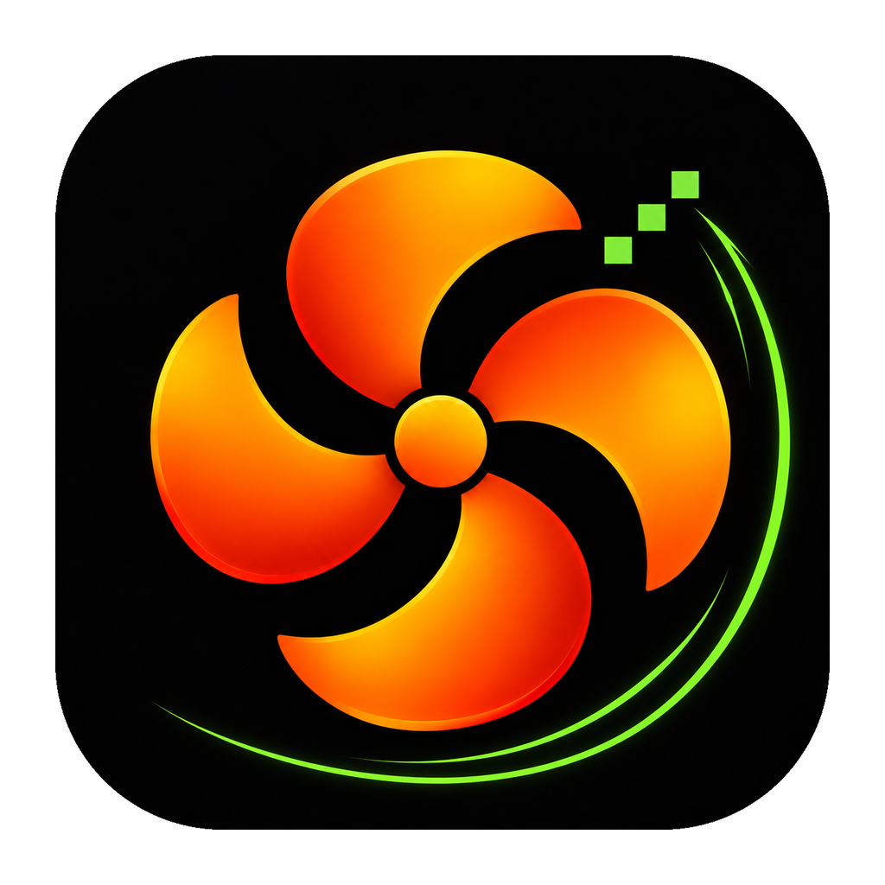

# My Fan Control



A free, open-source, native macOS utility for temperature monitoring and fan control. Built with SwiftUI, Swift Charts and a small C/IOKit bridge. No web view, Electron, accounts, subscriptions or network service.

**Early preview:** live monitoring has been tested on an Apple Silicon Mac. Saved presets at 2500/2950 RPM and return to automatic were measured on an M4 Pro. Other models, thermal stress and sleep/wake recovery still need hardware validation. Monitoring starts without changing fan settings. The interface supports Vietnamese and English, with an immediate language switch in Settings.

## Features

- Live fan RPM and hardware minimum/maximum, refreshed every two seconds.
- Searchable temperature sensors; unknown SMC keys retain their raw identities.
- Chip-aware component labels and explanations, with community source links and an option to reveal unidentified keys. See [what the sensors measure](docs/sensors.md).
- Automatic control, bounded fixed RPM, and a linear temperature-based fan curve per fan.
- One shared manual control for all fans, with per-fan limit validation and rollback on partial failure.
- Save and reuse named fan presets locally.
- Visible preset selection, update/copy actions, and a direct Apply flow that requests macOS authorization when needed. See [preset-flow changes](docs/preset-activation-upgrade.md).
- A menu bar temperature/RPM summary, temperature history and °C/°F display.
- Native Vietnamese/English localization with a saved language preference.
- Delayed countdowns, one-off date schedules, and weekly schedules per fan/preset, with bounded durations, conflict checks, cancellation, activity history and automatic-mode restoration.
- An on-demand privileged helper with a ten-second client lease and automatic-mode restoration attempts on expired leases, telemetry loss, high temperatures, write errors and normal termination.

## Requirements and build

Download the Apple Silicon preview from [GitHub Releases](https://github.com/Thanhthien94/my-fan-control/releases), then follow [INSTALL.md](INSTALL.md). Preview downloads require macOS's documented Open Anyway step because they are not Developer ID signed/notarized.

macOS 14 or later, Apple Silicon, and Xcode/Command Line Tools with Swift 6. Fan control requires a Mac with built-in SMC-controlled fans. No external package dependencies. Intel data formats are implemented but Intel hardware is not validated or supported by this preview release.

```sh
git clone https://github.com/Thanhthien94/my-fan-control.git
cd my-fan-control
./script/build_and_run.sh
```

The script builds a real app bundle at `dist/MyFanControl.app`, signs it ad hoc for local use, and opens it. Use `--build-only` to package without opening. `MFC_DEVELOPER_DIR` and `MFC_SDK_PATH` allow explicit toolchain/SDK selection; no global Xcode settings are changed.

```sh
./script/test.sh
./dist/MyFanControl.app/Contents/MacOS/fanctl snapshot
```

The test suite uses fake hardware; it never writes to real fans. The snapshot CLI is read-only and uses actual AppleSMC data, never demo values.

## Using controls

1. Quit other fan-control utilities to avoid competing writes.
2. Open the app and verify live fan and sensor readings.
3. Click **Bật điều khiển…** (Enable controls). macOS asks for administrator permission to launch this app's `fanctl` helper. Enabling alone does not select a manual fan policy.
4. Select a fan, choose a policy and click **Áp dụng cho quạt này** (Apply to this fan).
5. **Tất cả tự động** returns this session's controlled fans to automatic. **Tắt điều khiển** stops the helper after restoration. Closing the main window keeps the menu bar app running; quitting requests restoration and ends the session.

Presets are saved locally and are not automatically applied on startup. Curve thresholds are always expressed in Celsius, including when sensor display uses Fahrenheit. The history chart and menu bar temperature also use Celsius.

## Schedules and timers

Save a fixed-RPM or sensor preset first, then open **Schedules & timers** from the toolbar. Choose a delayed countdown (0 minutes starts immediately), a specific future date, or selected weekdays and a local start time. Select the fans and a duration from 1 minute to 24 hours. See [scheduling behavior](docs/scheduling.md) for exact ownership and missed-job rules.

Schedules run only while the app is open, the Mac is awake and controls are already authorized. They never wake the Mac or silently elevate privileges. Starts delayed by more than 60 seconds are skipped. Saved schedules are retained, but expired one-off jobs are not replayed on restart. Overlapping enabled schedules for the same fan are rejected; runtime checks also skip fans already controlled manually.

This preview is ad-hoc signed, **not Developer ID signed or notarized**. A downloaded bundle may be blocked by Gatekeeper. Building from source is the recommended preview installation. Do not disable system security to run it.

## Hardware and safety limits

AppleSMC is an undocumented, model-dependent interface. Supported numeric decoders are `flt `, `sp78`, `fpe2`, `ui8 `, `ui16` and `ui32`. A fan requires readable current/min/max keys. RPM requests must stay within hardware bounds; fan-stop requests below the reported minimum are rejected.

The helper rereads hardware at the privilege boundary and validates policies independently from the UI. It restores owned fans when any discovered temperature reaches 90°C, all sensors disappear, a selected sensor disappears, a read/write fails, or the client lease expires. It retries failed restoration. It never reapplies a saved custom policy after restarting.

Restoration is a best-effort hardware operation, not a guarantee. A killed/crashed helper, power loss, an unsupported SMC mode, or a driver failure can prevent it. SIGKILL cannot be handled. This preview has not been thermally stress-tested and is not a substitute for the Mac's own thermal protection. Sleep/wake recovery is implemented but not hardware-verified.

The helper does not install a persistent system daemon. Its socket is `/var/run/vn.thiendev.myfancontrol-<uid>.sock`, with user-only permissions and kernel peer-UID checks in both directions. Other processes running as the same user can issue the same narrow fan commands; client identity is UID-based, not code-signature based. See [security design](docs/security.md).

If a crashed helper leaves a socket behind, first verify that no `fanctl serve` process remains, return fan control to automatic with a trusted utility (or restart the Mac), and remove only this app's stale socket with administrator privileges. The helper deliberately refuses to overwrite existing paths.

## Development and releases

| Branch | Purpose |
| --- | --- |
| `main` | Reviewed release source, including explicitly marked previews |
| `develop` | Integration for the next release |
| `feature/<name>` | Feature work branched from `develop` |
| `fix/<name>` | Fixes targeting `develop` |
| `release/<version>` | Release preparation, merged into `main` and back to `develop` |
| `hotfix/<name>` | Urgent fixes from `main`, merged into both long-lived branches |

Release tags use SemVer, such as `v0.1.0-preview.1`. Preview releases explicitly list unverified hardware behavior. See [CONTRIBUTING.md](CONTRIBUTING.md) for the PR workflow and [verification notes](docs/verification.md) for current evidence.

## Independence and license

MIT licensed. This is an independent project, unaffiliated with Apple or CrystalIDEA. Macs Fan Control is a product of CrystalIDEA. See [analysis notes](docs/reverse-engineering.md) for the limited static observations used to guide the separate architecture, and the [licensing review](docs/legal-and-licensing.md) for artwork, notices, distribution claims and remaining limits.
